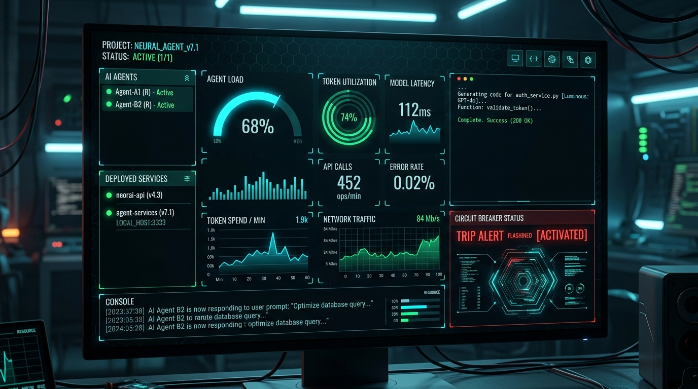

<div align="center">

# 🚀 AgentCockpit

### Real-Time Visual Telemetry HUD & Circuit Breaker for AI Coding Agents
**Stop watching text scroll in your terminal. See what your AI agent is doing in real-time.**

<br />



<br />

[](https://github.com/SECRET4422/agent-cockpit/actions)
[](https://npmjs.com/package/@ssgk4422/agent-cockpit)
[](https://opensource.org/licenses/MIT)
[](http://makeapullrequest.com)

[**Quickstart**](#-quickstart) •
[**Interactive Demo**](#-interactive-flight-simulation) •
[**Architecture**](#-architecture) •
[**Integration**](#-agent-integration) •
[**AlphaTech Studio**](https://alphatech.studio)

</div>

---

## ⚡ The Problem

When running autonomous coding agents (**Cursor**, **Claude Code**, **OpenMausBot**, **Aider**, **Cline**), developers are forced to stare at black-box terminal logs:
- ❌ **Runaway Loop Burn:** Agents repeat identical commands or oscillate between failing tests, burning **$10–$50** before you notice.
- ❌ **Blind Token Velocity:** No real-time visibility into $/min burn rate or prompt saturation.
- ❌ **Destructive Commands:** Unchecked shell commands or sensitive `.env` file mutations happen before you can hit `Ctrl+C`.

## 🛰️ The Solution: AgentCockpit

**`AgentCockpit`** is a zero-config, cyberpunk glassmorphic local HUD running on `localhost:3333`. It monitors your agent sessions, plots a real-time call recurrence radar, tracks token velocity, and provides an **autonomous circuit breaker** that halts runaway loops before they drain your API credits.

```
                     ┌───────────────────────────────────────────────┐
                     │          Autonomous AI Agent                  │
                     │   (Cursor / Claude Code / OpenMausBot)        │
                     └───────────────────────┬───────────────────────┘
                                             │ POST /api/event (or auto-proxy)
                                             ▼
                     ┌───────────────────────────────────────────────┐
                     │          AgentCockpit Local Daemon            │
                     │                                               │
                     │  ┌──────────────────┐  ┌───────────────────┐  │
                     │  │   LoopBreaker    │  │   Token Velocity  │  │
                     │  │  Recurrence Radar│  │    Speedometer    │  │
                     │  └────────┬─────────┘  └───────────────────┘  │
                     │           │ Critical Loop Trip (>85%)         │
                     │           ▼                                   │
                     │  ┌──────────────────┐  ┌───────────────────┐  │
                     │  │ Emergency Freeze │  │   Security Gate   │  │
                     │  │  Circuit Breaker │  │  (AST & Destruct) │  │
                     │  └──────────────────┘  └───────────────────┘  │
                     └───────────────────────┬───────────────────────┘
                                             │ SSE Stream
                                             ▼
                     ┌───────────────────────────────────────────────┐
                     │     Glassmorphic Live Browser Telemetry HUD   │
                     │             http://localhost:3333             │
                     └───────────────────────────────────────────────┘
```

---

## ⚡ Quickstart

Launch the visual cockpit instantly with zero setup:

```bash
# Launch interactive HUD with live simulated agent flight
npx @ssgk4422/agent-cockpit --demo
```

Or run standard monitoring mode on your preferred port:

```bash
npx @ssgk4422/agent-cockpit --port 3333
```

Your browser will automatically open to `http://localhost:3333`.

---

## 🎮 Interactive Flight Simulation

Want to see how `AgentCockpit` catches an agent runaway loop in action?

Run with the `--demo` flag or click the **"Simulate Flight"** button in the top navigation bar:
1. The agent starts reasoning and exploring files.
2. It executes tool calls (`read_dir`, `grep_search`).
3. It performs a file mutation (`auth.ts`).
4. It encounters a compiler error and enters a rapid, repetitive test loop (`npm test`).
5. Watch the **Loop Risk Radar** jump from `0%` to `40%` to `85%`.
6. At 4 repetitions, the **LoopBreaker Circuit Breaker** automatically trips, displays the emergency warning, triggers an audio alert, and halts the agent!

---

## 🛠️ Features

### 1. 🎯 Real-Time Loop Recurrence Radar
Powered by the proven algorithm from [`@ssgk4422/loopbreaker`](https://github.com/SECRET4422/loopbreaker):
- Sliding-window hash analysis of tool call signatures and arguments.
- Detects immediate duplicate repetitions and alternating 2-step oscillation loops ($A \rightarrow B \rightarrow A \rightarrow B$).
- Color-coded risk meter:
  - **0% – 39%:** `NOMINAL` (Green)
  - **40% – 79%:** `ELEVATED` (Amber)
  - **80% – 100%:** `CRITICAL` (Red - Breaker Trips)

### 2. ⚡ Token Burn Velocity Gauge
- Real-time speedometer tracking token spend in **$/minute** and **tokens/second**.
- Live session token ledger (Input, Output, Cumulative USD cost).
- Configured for frontier models (Claude 3.5 Sonnet, GPT-4o, DeepSeek V3).

### 3. 🚨 1-Click Emergency Freeze Killswitch
- Big physical glowing killswitch toggle in the HUD header.
- Instantly halts event ingestion, sets agent state to `BREAKER_TRIPPED`, and signals connected client wrappers to freeze execution.
- 1-click **Reset & Resume** button once the developer inspects the diff.

### 4. 🛡️ AST & Security Gate
- Flags catastrophic shell patterns (`rm -rf /`, fork bombs, curl-pipe-sh).
- Intercepts accidental `.env`, `.ssh/`, and sensitive dotfile mutations before commits.

---

## 🔌 Agent Integration

Sending events from your own agent scripts, Cursor rules, or Python workflows is as simple as a single HTTP POST request:

### cURL
```bash
curl -X POST http://localhost:3333/api/event \
  -H "Content-Type: application/json" \
  -d '{
    "agentName": "Cursor Agent",
    "type": "tool_call",
    "tool": "edit_file",
    "args": { "file": "src/auth.ts" }
  }'
```

### TypeScript / Node.js
```typescript
await fetch('http://localhost:3333/api/event', {
  method: 'POST',
  headers: { 'Content-Type': 'application/json' },
  body: JSON.stringify({
    agentName: 'Claude Code',
    type: 'tool_call',
    tool: 'run_command',
    args: { cmd: 'cargo test' }
  })
});
```

### Python
```python
import requests

requests.post('http://localhost:3333/api/event', json={
    'agentName': 'AutoGPT / CrewAI',
    'type': 'thought',
    'message': 'Refactoring database schema...'
})
```

---

## 🧪 Testing & Verification

```bash
# Clone the repository
git clone https://github.com/SECRET4422/agent-cockpit.git
cd agent-cockpit

# Install and build
npm install
npm run build

# Run test suite
npm test
```

All test suites verify loop detection accuracy, token cost math, security guards, and HTTP/SSE endpoints.

---

## 🏛️ Engineered by AlphaTech Studio

Built by **Prabhakar Pal** ([@SECRET4422](https://github.com/SECRET4422)) at [**AlphaTech Studio**](https://alphatech.studio).

Complements our open-source agent reliability stack:
- [`loopbreaker`](https://github.com/SECRET4422/loopbreaker) — Autonomous AI bug-loop interrupter & circuit breaker.
- [`guardrail-mcp`](https://github.com/SECRET4422/guardrail-mcp) — Enterprise multi-language security & AST policy gate.
- [`visual-smoke`](https://github.com/SECRET4422/visual-smoke) — Zero-code automated localhost visual smoke testing & invariant guard.
- [`vision-craft`](https://github.com/SECRET4422/vision-craft) — Screenshot-to-Fullstack live sandbox with 1:1 ghost diffs.
- [`mcp-deep-research-server`](https://github.com/SECRET4422/mcp-deep-research-server) — Autonomous deep web research & synthesis engine.

---

## 📄 License

MIT © [Prabhakar Pal](https://github.com/SECRET4422) · [AlphaTech Studio](https://alphatech.studio)
